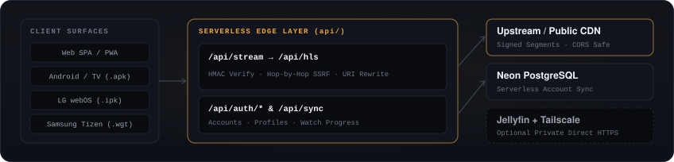

<div align="center">
  <picture>
    <source media="(prefers-color-scheme: dark)" srcset="./assets/banner-dark.svg" />
    <source media="(prefers-color-scheme: light)" srcset="./assets/banner-light.svg" />
    
  </picture>

  <br /><br />

  <a href="https://zenovaplus.vercel.app">Live App</a>
  &nbsp;&nbsp;·&nbsp;&nbsp;
  <a href="#architecture">Architecture</a>
  &nbsp;&nbsp;·&nbsp;&nbsp;
  <a href="#capabilities">Capabilities</a>
  &nbsp;&nbsp;·&nbsp;&nbsp;
  <a href="#local-development">Local Development</a>
  &nbsp;&nbsp;·&nbsp;&nbsp;
  <a href="#environment-variables">Environment</a>
  &nbsp;&nbsp;·&nbsp;&nbsp;
  <a href="packaging/README.md">Packaging</a>
</div>

<br />

`Zenova` is a cross-platform media streaming platform running on a zero-VPS serverless architecture. It delivers a unified web, desktop, and smart-TV playback interface backed by an HMAC-signed HLS proxy, Neon PostgreSQL account synchronization, and optional direct playback from a private Jellyfin server over Tailscale.

Live deployment: **[zenovaplus.vercel.app](https://zenovaplus.vercel.app)**

## Architecture

<div align="center">
  <picture>
    <source media="(prefers-color-scheme: dark)" srcset="./assets/architecture-dark.svg" />
    <source media="(prefers-color-scheme: light)" srcset="./assets/architecture-light.svg" />
    
  </picture>
</div>

<br />

Zenova separates the static Vite + React client (`src/`) from serverless edge handlers (`api/`) and Neon PostgreSQL state. When resolving protected streams, `/api/stream` returns signed paths pointing to `/api/hls` so clients never inspect upstream URLs or required origin headers directly.

Inside `/api/hls`, every request verifies the HMAC signature, validates public IP ranges at each manual redirect hop (`followSafely`) to block SSRF redirects to localhost or private networks, and rewrites HLS manifests including `#EXT-X-MAP` and `#EXT-X-KEY` URIs so browsers and smart TVs play segments without CORS rejections.

## Capabilities

| Component | Implementation |
|---|---|
| **Signed HLS Proxy (`api/hls.ts`)** | Verifies HMAC signatures, inspects redirect targets hop-by-hop against private IP ranges (SSRF protection), injects upstream origin headers, and rewrites HLS manifests including fMP4 `#EXT-X-MAP` and AES `#EXT-X-KEY`. |
| **Direct Source Isolation (`api/stream.ts`)** | Resolves upstream streams server-side via modular `StreamManager` resolvers; public-domain sources marked `requiresProxy: false` bypass unnecessary proxy bandwidth. |
| **Account & Progress Sync (`api/auth/*`, `api/sync.ts`)** | Stateless signed token auth, multi-profile gates with optional PIN protection, and watch-progress sync persisted in `@neondatabase/serverless` PostgreSQL. |
| **Multi-Platform Clients** | Builds from one TypeScript codebase to Web PWA, Android / Android TV (`@capacitor/android`), LG webOS (`.ipk`), and Samsung Tizen (`.wgt`). |
| **Personal Media Mode** | Connects directly to your own **Jellyfin** instance over **Tailscale** HTTPS without port forwarding, VPS hosting, or ads. |
| **Adaptive Playback UI** | Built with React 19, TypeScript, Tailwind CSS v4, `@vidstack/react`, and `hls.js`. |

## Local Development

```bash
git clone https://github.com/e12jassir/zenova.git && cd zenova
npm install
```

Start the unified development server (runs Vite SPA alongside local `api/*` serverless endpoints on the same origin so `/api/stream` and `/api/hls` work locally):

```bash
npm run dev:full
```

Optional test HLS resolver flag:

```bash
STREAM_DEMO_RESOLVER=1 npm run dev:full
```

Verify types and build both frontend (`tsconfig.json`) and API functions (`tsconfig.api.json`):

```bash
npm run typecheck
npm run build
```

## Environment Variables

Configure these variables in Vercel / Cloudflare Pages or `.env.local` for local API persistence:

| Variable | Scope | Purpose |
|---|---|---|
| `DATABASE_URL` | Server | Neon PostgreSQL connection URI (`postgres://...`) |
| `AUTH_SECRET` | Server | Secret key used to sign account sessions and auth tokens |
| `STREAM_SIGNING_SECRET` | Server | HMAC secret for signing temporary `/api/stream` and `/api/hls` URLs |
| `VITE_API_URL` | Client build | Public backend origin when compiling packaged Android TV, webOS, or Tizen apps (`capacitor://` / `file:///`) |
| `STREAM_DEMO_RESOLVER` | Optional (`1`) | Enables the local verification demo HLS resolver |

---

<details>
<summary><strong>Cross-Platform Packaging (Android TV, LG webOS, Samsung Tizen)</strong></summary>

Packaged smart-TV and mobile builds run from local origins (`capacitor://` or `file:///`). Compile with `VITE_API_URL` pointing to your deployed serverless backend first:

```bash
VITE_API_URL=https://zenovaplus.vercel.app npm run build
```

**Android & Android TV (Capacitor + ADB)**

```bash
npx cap sync android
cd android && ./gradlew assembleDebug
adb connect <TV_IP>:5555
adb install -r app/build/outputs/apk/debug/app-debug.apk
```

**LG webOS (`.ipk`) & Samsung Tizen (`.wgt`)**

```bash
npm run package:webos   # outputs LG webOS package
npm run package:tizen   # outputs Samsung Tizen package
npm run package         # runs full TV packaging pipeline
```

Packaging scripts automatically filter prior heavy artifacts (`.apk`, `.wgt`, `.ipk`, `.zip`, `.map`) via `IGNORED_ARTIFACT`. See [`packaging/README.md`](packaging/README.md) for signing certificates, CLI setup, and store manifests.

</details>

<details>
<summary><strong>Personal Media Setup (Jellyfin + Tailscale)</strong></summary>

1. Install **Jellyfin** on a home server or mini-PC.
2. Install **Tailscale** on the Jellyfin host and on your client devices (web browser, mobile, Android TV).
3. Copy the private HTTPS URL assigned by Tailscale Serve for your Jellyfin server.
4. Open **Ajustes -> Servidor Personal** inside Zenova and save the URL.

</details>

<details>
<summary><strong>Project Layout</strong></summary>

```text
zenova/
├── api/
│   ├── _lib/          # Neon PostgreSQL client, auth token & HMAC stream signing
│   ├── auth/          # login / register handlers
│   ├── hls.ts         # Signed HLS proxy with SSRF hop validation & manifest rewrite
│   ├── search.ts      # Metadata search endpoint
│   ├── stream.ts      # Source resolver entrypoint
│   └── sync.ts        # Account state & progress synchronization
├── android/           # Capacitor Android & Android TV project
├── packaging/         # LG webOS & Samsung Tizen packagers and guides
├── scripts/           # Unified local SPA + serverless API dev server
└── src/
    ├── core/          # Providers and modular stream resolvers
    ├── components/    # Player, profiles, rails, navigation, glass modals
    └── pages/         # Home, Browse, Categories, Search, MyList, Settings
```

</details>

<br />

<p align="center">
  <sub>Live at <a href="https://zenovaplus.vercel.app">zenovaplus.vercel.app</a> &nbsp;·&nbsp; <a href="https://github.com/e12jassir">Esteban Marrugo</a></sub>
</p>
